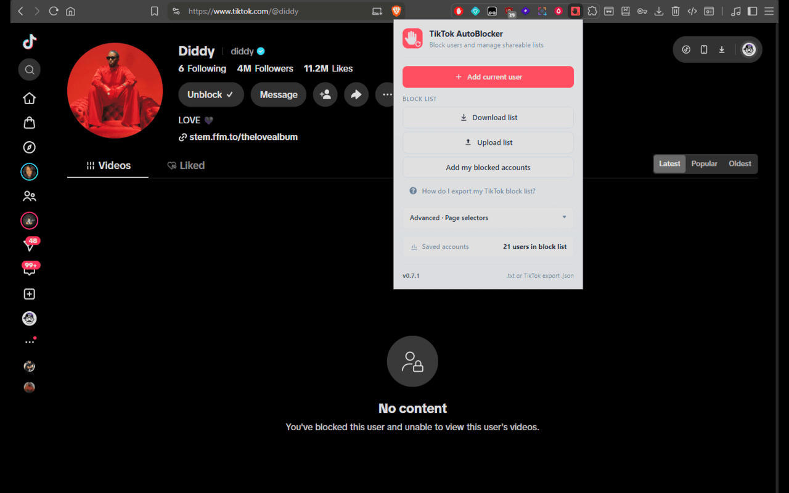

# TikTok AutoBlocker

[](https://github.com/jimididit/tiktok-autoblocker/actions/workflows/ci.yml)


Mass-block TikTok accounts from a list, and keep a shareable block list - Chrome extension and Tampermonkey.

<p>
  
</p>

## Quick start

1. Install from the [Chrome Web Store](https://chromewebstore.google.com/detail/tiktok-autoblocker/aimhdnemlhpkecbdhgclkckcfgpgolln) (or [load unpacked / Tampermonkey](docs/install.md)).
2. Open [tiktok.com](https://www.tiktok.com) while logged in.
3. Open the extension popup, upload a `.txt` of usernames (one per line), and let the queue run.

```txt
@username1
@username2
username3
```

## Features

- Mass block from `.txt` or TikTok data-export JSON
- Pause / resume; remaining count on the toolbar badge
- Add the open profile, download your saved list, import from [Blocked accounts](https://www.tiktok.com/setting/block-list)
- Multi-language Block menu matching; **Page selectors** (Pick) if TikTok redesigns the UI
- Tampermonkey build for other browsers

## Install

| Method | Guide |
| --- | --- |
| Chrome Web Store | [Listing](https://chromewebstore.google.com/detail/tiktok-autoblocker/aimhdnemlhpkecbdhgclkckcfgpgolln) |
| Load unpacked | [docs/install.md](docs/install.md#load-unpacked-development) |
| Tampermonkey | [docs/install.md](docs/install.md#tampermonkey) |

## Usage

**Mass block:** prepare one username per line - `@name` or `name` - then **Upload list** in the popup or userscript card. The run opens each profile and uses TikTok's own Block / Confirm controls. Use **Pause** / **Resume** anytime.

**List tools:** **Add current user**, **Download list**, and on the Blocked accounts page **Add my blocked accounts** (appends only; does not start blocking).

**Bring an existing TikTok block list:** [docs/export-block-list.md](docs/export-block-list.md)

## When TikTok changes the UI

Open **Advanced · Page selectors**, **Pick** the Actions / Block / Confirm controls, then **Save**. Full steps: [docs/page-selectors.md](docs/page-selectors.md).

## Compatibility

- Targets TikTok **web** (`*.tiktok.com`) while you are logged in.
- Built-in matchers cover common UI languages; use Page selectors for anything else.
- Chrome extension is Manifest V3. Tampermonkey works in browsers that support userscripts.

## Docs

- [Install](docs/install.md)
- [Export / import your TikTok block list](docs/export-block-list.md)
- [Page selectors](docs/page-selectors.md)
- [Troubleshooting](docs/troubleshooting.md)
- [Releases](https://github.com/jimididit/tiktok-autoblocker/releases) (version history and notes)

## Contributing

Issues and pull requests are welcome. For large changes, open an issue first. Keep the Chrome extension and Tampermonkey script in lockstep when behavior is shared.

## Support

[GitHub Issues](https://github.com/jimididit/tiktok-autoblocker/issues)

## Disclaimer

Use responsibly and follow TikTok's terms of service. You are responsible for how you use this tool on your account.
